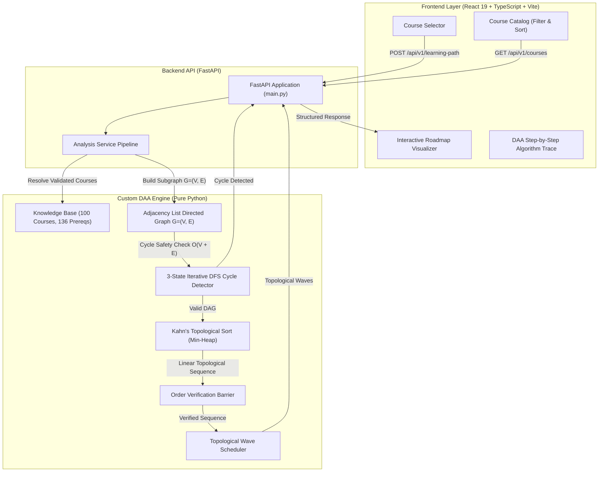

# Dependency-Aware Course Registration Assistant

<div align="center">
  
  <h2>Project-Based Learning (PBL 2) — Design & Analysis of Algorithms</h2>
  <p><strong>A deterministic Graph Algorithm engine that models university curricula as Directed Acyclic Graphs (DAGs), detects circular prerequisite deadlocks, and generates valid course-taking orders using Kahn’s Topological Sort.</strong></p>

  <p align="center">
    <a href="https://pathwise-daa-project.vercel.app/">
      
    </a>
  </p>
</div>

---

## 👥 Project Team & Academic Credentials

- **Course:** Design and Analysis of Algorithms (DAA) — Problem-Based Learning (PBL 2)
- **Institution:** Manav Rachna International Institute of Research and Studies (MRIIRS), School of Engineering & Technology, Department of Computer Science & Engineering (Batch 2024–2028)
- **Team Members & Roll Numbers:**
  1. **Vaibhav Gupta** — `1/24/SET/BCS/408`
  2. **Chirag Chauhan** — `1/24/SET/BCS/430`
  3. **Mayank** — `1/24/SET/BCS/438`
  4. **Kunal Mishra** — `1/24/SET/BCS/446`

---

## 🎯 Problem Statement & Guidelines

> **Project Specification:**
> *"Build a tool that represents course prerequisites as a directed graph, detects invalid prerequisite cycles, and generates a valid course-taking order. Evaluate it on synthetic curricula and explain how topological ordering supports reliable planning."*
> **Core Concepts:** Directed graphs ($G=(V, E)$), cycle detection (3-state DFS coloring), topological sorting (Kahn's in-degree decay algorithm), and rigorous test-case design.

Designing a multi-semester academic course schedule is a fundamental dependency sequencing problem. When students select specialized subjects, prerequisite relationships can create intricate directed dependency networks with risks of:
1. **Circular Deadlocks ($A \to B \to C \to A$):** Rendering registration mathematically impossible.
2. **Prerequisite Violations:** Enrolling in advanced topics before completing foundational requirements.

This project implements a pure DAA engine in Python with a modern interactive frontend, providing complete mathematical guarantees for academic scheduling.

---

## 📖 Table of Contents
- [Key Features](#-key-features)
- [System Architecture](#-system-architecture)
- [How Topological Ordering Supports Reliable Planning](#-how-topological-ordering-supports-reliable-planning)
- [DAA Algorithms & Mathematical Guarantees](#-daa-algorithms--mathematical-guarantees)
- [Curriculum Knowledge Base (100 Courses)](#-curriculum-knowledge-base-100-courses)
- [Project Directory Structure](#-project-directory-structure)
- [Local Setup & Execution](#-local-setup--execution)
- [Automated Test Suite](#-automated-test-suite)

---

## ✨ Key Features

- **100 Curated B.Tech CSE Courses & 136 Prerequisite Dependencies:** Full curriculum coverage across Semesters 1 through 8 directly mapped from the official MRIIRS syllabus booklet.
- **Cycle Detection & Path Isolation:** Identifies directed circular dependencies via 3-state iterative DFS ($\mathcal{O}(V + E)$) with zero risk of call-stack overflow, extracting the exact conflict path ($A \to B \to A$).
- **Deterministic Kahn's Topological Sorting:** Computes a valid study order with min-heap tie-breaking ($\mathcal{O}(V \log V + E)$) ensuring reproducible registrations.
- **Topological Wave Partitioning:** Naturally groups courses into prerequisite waves, allowing students and colleges to see which courses can be taken concurrently.
- **Interactive Visual Roadmap:** Responsive road-inspired visual journey rendered with React 19, TypeScript, and Tailwind CSS.
- **DAA Algorithm & Step-by-Step Visualizer:** Interactive educational trace detailing in-degree decay, queue states, and execution step logs.
- **Catalog Explorer with Filter & Sort:** Filter courses by semester (1–8), subject domain, difficulty, or search query with customizable sort orders.

---

## 🎓 How Topological Ordering Supports Reliable Planning

In university curricula, prerequisite relations define a directed graph $G = (V, E)$. Topological sorting provides the core mathematical guarantees that make degree planning reliable and conflict-free:

1. **Guaranteed Prerequisite Precedence (No Forward References):**
   A topological ordering guarantees:
   $$\forall (u, v) \in E \implies \text{index}(u) < \text{index}(v)$$
   This proves mathematically that a student will never encounter advanced material without having completed all underlying foundations.

2. **Deadlock & Cycle Immunity (The DAG Property):**
   A topological ordering exists **if and only if** the graph is a Directed Acyclic Graph (DAG). If an invalid circular dependency is introduced ($A \to B \to C \to A$), registration becomes mathematically impossible. Kahn's algorithm catches this immediately (as vertices processed $< |V|$), and 3-state DFS isolates the exact cycle path, preventing registration deadlocks.

3. **Natural Concurrent Semester Waves (In-Degree Decay):**
   At each step of Kahn's algorithm, all courses with $\text{in-degree} = 0$ are mutually independent. This directly maps to **semester scheduling**: all 0-in-degree courses can be safely scheduled in the **same semester** concurrently without prerequisite conflict.

4. **Deterministic & Objective Degree Pathways:**
   Deterministic tie-breaking (min-heap priority) guarantees an objective, reproducible schedule for thousands of students simultaneously, eliminating manual advisor bottlenecks and registration errors.

---

## 🏗️ System Architecture



---

## 🧮 DAA Algorithms & Mathematical Guarantees

All graph data structures and scheduling algorithms are implemented from scratch in pure Python (`backend/daa_engine/`) with no third-party graph dependencies.

### 1. Kahn’s Algorithm for Topological Sorting (In-Degree Decay)
- **File:** `backend/daa_engine/graph.py`
- **Time Complexity:** $\mathcal{O}(V \log V + E)$
- **Space Complexity:** $\mathcal{O}(V + E)$
- **Algorithm Flow:**
  1. Compute the in-degree $\text{indeg}[v] = |\{u \in V \mid (u, v) \in E\}|$ for each vertex $v \in V$.
  2. Initialize a min-heap with all vertices having $\text{indeg}[v] = 0$.
  3. While the heap is not empty, extract the minimum vertex $u$, append it to the topological ordering, and for each outgoing edge $(u, w) \in E$, decrement $\text{indeg}[w]$. If $\text{indeg}[w] = 0$, push $w$ onto the heap.
  4. If the final ordering contains fewer than $|V|$ vertices, a cycle is present; otherwise, the ordering is mathematically valid.

### 2. Iterative 3-State DFS Cycle Detection
- **File:** `backend/daa_engine/graph.py`
- **Time Complexity:** $\mathcal{O}(V + E)$
- **Space Complexity:** $\mathcal{O}(V)$
- **Three-Color Scheme:**
  - `0 (WHITE)`: Unvisited node.
  - `1 (GRAY)`: Currently active in the DFS traversal stack.
  - `2 (BLACK)`: Completely visited with all descendants explored.
- Encountering an edge to a `GRAY` node signals a back-edge, proving the existence of a directed cycle. Uses an iterative call stack to prevent Python call-stack exhaustion.

### 3. Topological Order Verification
- **File:** `backend/daa_engine/graph.py`
- **Time Complexity:** $\mathcal{O}(V + E)$
- Validates the three fundamental invariants of topological sorting:
  $$\forall (u, v) \in E \implies \text{index}(u) < \text{index}(v)$$
  $$|L| = |V| \quad \text{and} \quad \text{set}(L) = V$$

---

## 📚 Curriculum Knowledge Base (100 Courses)

The knowledge base (`backend/knowledge_base/courses.json`) contains **100 officially mapped courses** and **136 verified prerequisite relationships** spanning Semesters 1 through 8:

| Semester | Core & Elective Subjects | Prerequisite Anchors |
| :---: | :--- | :--- |
| **Sem 1** | Physics for Engineers, Chemistry for Engineers, Mathematics-I, Basics of Electrical & Electronics Engineering, Engineering Graphics & CAD, Manufacturing Practices, Programming Fundamentals, C Programming, Linear Algebra, Calculus, Technical Communication | Foundational (In-degree = 0) |
| **Sem 2** | Mathematics-II, Professional Communication, Environmental Science, Python Programming, C++ Programming, Discrete Mathematics | Math-I $\to$ Math-II |
| **Sem 3** | Data Structures, Object-Oriented Programming, Probability & Statistics, Digital Electronics & Logic Design, Cyber Law & Ethics, Mathematics-III, Design Thinking, Linux Administration, Programming in R | BEEE $\to$ Digital Electronics, Math-II $\to$ Math-III |
| **Sem 4** | Design and Analysis of Algorithms, Computer Organization & Architecture, Database Management Systems, Web Development, Java Programming, Numerical Methods, Graph Theory, Functional Programming | Data Structures $\to$ DAA |
| **Sem 5** | Operating Systems, Computer Networks, Theory of Computation, Software Engineering, Artificial Intelligence, Machine Learning, Data Science, Formal Languages & Automata, Data Warehousing, Kubernetes, Docker, Real Time Systems, Software Testing | Discrete Math $\to$ FLAT, DBMS $\to$ Data Warehouse, OS $\to$ Docker |
| **Sem 6** | Deep Learning, Natural Language Processing, Computer Vision, Compiler Design, Data Mining, Cloud Computing, Cryptography, Advanced DBMS, Sensor Technologies, NoSQL Databases, Mobile App Dev, Data Visualization, Embedded Systems | Docker $\to$ Kubernetes, DBMS $\to$ Advanced DBMS |
| **Sem 7** | Reinforcement Learning, Big Data Analytics, Distributed Systems, Cybersecurity, Robotics, System Design, DevOps, MLOps, Simulation & Modelling, Parallel & Distributed Algorithms, Advanced Networks, Network Security, Distributed OS, Pattern Recognition | DAA $\to$ Parallel Algorithms, Networks $\to$ Advanced Networks, Crypto $\to$ Network Security |
| **Sem 8** | Generative AI, Large Language Models, RAG, Information Retrieval, Computer Graphics, Quantum Computing, AI Ethics, Blockchain, Multimodal Deep Learning, Discrete Optimization, Deep RL, Edge AI, Fuzzy Theory, Wireless Sensor Networks, Advanced Computer Architecture | COA $\to$ Advanced Architecture, Networks $\to$ WSN |

---

## 📁 Project Directory Structure

```
Pathwise_DAA_Project/
├── api/
│   └── index.py                     # Vercel serverless entrypoint
├── backend/
│   ├── core_engine/                 # API service layer & schemas
│   │   ├── main.py                  # FastAPI application & endpoints
│   │   ├── analysis_service.py      # Registration scheduling pipeline
│   │   └── models.py                # Pydantic request/response schemas
│   ├── daa_engine/                  # Pure Python DAA Graph Algorithms
│   │   ├── graph.py                 # DirectedGraph, Kahn's Toposort, 3-state DFS
│   │   └── scheduler.py             # Topological wave scheduler
│   └── knowledge_base/              # Academic curriculum knowledge base
│       ├── courses.json             # 100 courses, 136 prerequisite relationships
│       ├── knowledge_base.py        # In-memory query resolver
│       └── validate_kb_by_Claude.py # Automated structural validator
├── final_frontend/                  # React 19 + TypeScript + Vite + Tailwind CSS
│   ├── src/
│   │   ├── components/              # Roadmap, CourseForm, DAA Inspector
│   │   ├── pages/                   # HomePage, DAAPage, CurriculumPage
│   │   ├── data/                    # coursesCatalog.ts (100 courses)
│   │   └── types/                   # TypeScript interfaces
│   └── package.json                 # Frontend dependencies
├── tests/                           # 118 Automated pytest unit & integration tests
├── requirements.txt                 # Backend dependencies
└── README.md                        # Project documentation (this file)
```

---

## 🚀 Local Setup & Execution

### 1. Prerequisites
- **Python:** 3.10+
- **Node.js:** 18+ and `npm`

### 2. Backend Setup
```bash
# In the project root:
python -m venv venv

# Windows (PowerShell):
.\venv\Scripts\Activate.ps1
# Linux / macOS:
source venv/bin/activate

# Install dependencies:
pip install -r requirements.txt

# Run the backend server:
python -m uvicorn backend.core_engine.main:app --reload --port 8000
```
Backend will be live at `http://127.0.0.1:8000` (API Docs: `http://127.0.0.1:8000/docs`).

### 3. Frontend Setup
```bash
cd final_frontend
npm install
npm run dev
```
Frontend will be live at `http://localhost:5173`.

---

## 🧪 Automated Test Suite

Run the complete test suite verifying all 100 courses, DAG acyclicity, Kahn's algorithm correctness, and API endpoints:

```bash
# Run all 118 unit and integration tests:
pytest
```

---

## 📄 License & Academic Attribution
Developed as part of the **Design and Analysis of Algorithms (DAA)** curriculum at **Manav Rachna International Institute of Research and Studies (MRIIRS)**.
Distributed under the MIT License.
