# Pathwise — AI-Assisted, Prerequisite-Aware Course Learning Path Generator

<div align="center">
  
  <p><strong>A deterministic Graph Algorithm engine paired with Google Gemini 2.5 Flash Lite for intelligent, prerequisite-aware academic course planning.</strong></p>

  [](https://www.python.org/)
  [](https://fastapi.tiangolo.com/)
  [](https://react.dev/)
  [](https://www.typescriptlang.org/)
  [](https://vitejs.dev/)
  [](tests/)
  [](docs/DEPLOYMENT.md)
  [](LICENSE)
</div>

---

## 📖 Table of Contents
- [Overview](#-overview)
- [Key Features](#-key-features)
- [System Architecture](#-system-architecture)
- [DAA Algorithms & Mathematical Guarantees](#-daa-algorithms--mathematical-guarantees)
- [Empirical Benchmarks](#-empirical-benchmarks)
- [Curated Knowledge Base](#-curated-knowledge-base)
- [Project Structure](#-project-structure)
- [Getting Started](#-getting-started)
- [Running Tests & Benchmarks](#-running-tests--benchmarks)
- [Vercel Deployment](#-vercel-deployment)
- [API Documentation](#-api-documentation)
- [Documentation Index](#-documentation-index)
- [Authors & Acknowledgments](#-authors--acknowledgments)

---
Live URL : pathwise-daa-project.vercel.app
## 🎯 Overview

Designing a multi-semester academic course schedule is a complex dependency problem. When students select specialized subjects, prerequisite relationships can create intricate directed graphs with risks of circular dependencies, prerequisite violations, and unbalanced semester workloads.

**Pathwise** resolves this challenge by pairing **Google Gemini 2.5 Flash Lite** with **custom Design and Analysis of Algorithms (DAA) graph algorithms**:
- **Natural Language Course Discovery:** Matches student queries, aliases, and typos, using Gemini to resolve ambiguous or interdisciplinary goals.
- **Deterministic Pure-Python Graph Engine:** Constructs directed prerequisite graphs without external graph packages (no NetworkX).
- **Cycle Detection & Path Isolation:** Identifies directed circular dependencies via 3-state iterative DFS with zero risk of call-stack overflow.
- **Topological Ordering:** Computes a valid study sequence using Kahn's algorithm with a min-heap for deterministic tie-breaking.
- **Pedagogical Semester Scheduling:** Allocates courses across academic semesters while balancing difficulty scores and course capacity limits.

---

## ✨ Key Features

- **70 Curated Courses & 115 Validated Prerequisite Relationships:** Pre-configured across 7 domains (Core CS, Systems, AI/ML, Data Science, Math, Security, Software Engineering).
- **Graceful Degradation & Resilience:** Seamlessly falls back to curated prerequisite mappings if the Gemini API is unreachable, offline, or unconfigured.
- **Cycle Conflict Extraction:** When circular prerequisites occur, Pathwise extracts the exact cycle path ($A \to B \to A$) and returns human-readable diagnostic error banners.
- **Interactive SVG Road-Style UI:** Responsive, road-inspired visual journey built with React 19, Tailwind CSS v4, and Lucide icons.
- **DAA Algorithm & Benchmark Inspector:** Interactive UI visualization demonstrating Kahn's in-degree transitions, DFS cycle detection, and live empirical latency metrics.
- **Zero Secret Exposure:** Strict security boundaries; API keys are never leaked through frontend bundles, responses, or git commits.

---

## 🏗️ System Architecture

Pathwise enforces a strict separation between AI reasoning and deterministic DAA algorithms:

```mermaid
flowchart TD
    subgraph Client["Frontend Layer (React 19 + TypeScript + Vite)"]
        UI["Course Selector & Career Tracks"]
        RoadmapView["Road-Style Visual Journey"]
        DAAView["Interactive DAA Algorithm Inspector"]
    end

    subgraph API["Backend API (FastAPI / Serverless)"]
        Router["FastAPI Application"]
        Analysis["Analysis Service Orchestration"]
    end

    subgraph AI["AI Layer (Google GenAI)"]
        GeminiClient["Gemini 2.5 Flash Lite"]
    end

    subgraph DAA["Custom DAA Engine (Pure Python)"]
        KB["Curated Knowledge Base (70 Courses, 115 Edges)"]
        Graph["Adjacency List Directed Graph"]
        Cycle["3-State Iterative DFS Cycle Detector"]
        Kahn["Kahn's Toposort with Min-Heap Tie-Breaking"]
        Verifier["Order Verification Barrier"]
        Scheduler["Multi-Priority Semester Scheduler"]
    end

    UI -->|"POST /api/v1/learning-path"| Router
    Router --> Analysis
    Analysis -->|"Resolve Query & Fallback"| KB
    Analysis -->|"Disambiguation & Proposals"| GeminiClient
    Analysis -->|"Construct Subgraph G=(V, E)"| Graph
    Graph -->|"Safety Check O(V log V + E)"| Cycle
    Cycle -->|"Valid DAG"| Kahn
    Kahn -->|"Linear Order"| Verifier
    Verifier -->|"Verified Sequence"| Scheduler
    Scheduler -->|"Balanced Semesters"| Router
    Router -->|"Structured Response"| RoadmapView
```



> **Architectural Boundary:** Gemini is restricted to semantic course mapping and prerequisite proposals. All graph construction, cycle detection, topological sorting, and semester scheduling are computed deterministically by the DAA engine.

---

## 🧮 DAA Algorithms & Mathematical Guarantees

Pathwise implements all algorithms in pure Python (`backend/daa_engine/`) to ensure complete transparency, algorithmic rigor, and determinism.

### 1. Deterministic Kahn's Algorithm with Min-Heap
- **File:** [`backend/daa_engine/graph.py`](backend/daa_engine/graph.py)
- **Time Complexity:** $\mathcal{O}(E + V \log V)$
- **Auxiliary Space:** $\mathcal{O}(V + E)$
- **Determinism:** When multiple courses reach in-degree 0 simultaneously, a Python `heapq` min-heap pops the lexicographically smallest course ID, guaranteeing consistent output across runs.

### 2. Iterative 3-State DFS Cycle Detection
- **File:** [`backend/daa_engine/graph.py`](backend/daa_engine/graph.py)
- **Time Complexity:** $\mathcal{O}(V \log V + E)$
- **Auxiliary Space:** $\mathcal{O}(V)$
- **Stack Safety:** Uses an explicit call stack `[(vertex, neighbor_index)]` rather than recursion, eliminating Python recursion limit crashes on deep linear chains ($V > 1500$).

### 3. Topological Order Verification
- **File:** [`backend/daa_engine/graph.py`](backend/daa_engine/graph.py)
- **Time Complexity:** $\mathcal{O}(V \log V + E)$
- **Invariants Checked:** $|order| = |V|$, $\text{set}(order) = V$, and $\forall (u, v) \in E: \text{pos}[u] < \text{pos}[v]$.

### 4. Multi-Priority Pedagogical Semester Scheduler
- **File:** [`backend/daa_engine/scheduler.py`](backend/daa_engine/scheduler.py)
- **Constraints:** Respects course prerequisite bounds, maximum courses per semester ($k$), and workload difficulty ceilings.
- **Prioritization:** Prioritizes courses on the critical path (longest remaining prerequisite chain).

---

## ⚡ Empirical Benchmarks

Benchmarked across 5 distinct graph topologies from $V=10$ to $V=1000$ (Windows 11, AMD64, Python 3.12.4):

| Topology | $|V|$ | $|E|$ | Algorithm | Median Latency | Correctness |
| :--- | :---: | :---: | :--- | :---: | :---: |
| **Sparse DAG** | 100 | 150 | Kahn Toposort | 0.079 ms | **PASSED** |
| Sparse DAG | 1000 | 1500 | Kahn Toposort | 1.134 ms | **PASSED** |
| **Dense DAG** | 100 | 495 | Kahn Toposort | 0.101 ms | **PASSED** |
| Dense DAG | 1000 | 49,950 | Kahn Toposort | 4.925 ms | **PASSED** |
| **Linear Chain** | 100 | 99 | Kahn Toposort | 0.059 ms | **PASSED** |
| Linear Chain | 1000 | 999 | Kahn Toposort | 0.790 ms | **PASSED** |
| **Disconnected DAG** | 1000 | 1500 | Kahn Toposort | 1.160 ms | **PASSED** |
| **Cyclic Graph** | 1000 | 1503 | DFS Cycle Detect | 0.708 ms | **PASSED (Cycle Found)** |

*Run benchmarks locally with: `python benchmarks/benchmark_daa.py`*

---

## 📚 Curated Knowledge Base

The curated catalog (`backend/knowledge_base/courses.json`) contains **70 core academic courses** with **115 verified prerequisite edges**:
- **Categories:** Core Computer Science, Mathematics, Systems & Infrastructure, Artificial Intelligence & Machine Learning, Data Science & Analytics, Security & Cryptography, Software Engineering.
- **Metadata:** Canonical course ID, title, full description, credit units (3–4), difficulty level (1–5), and direct prerequisite IDs.
- **Verification:** Verified acyclic and structurally valid via [`backend/knowledge_base/validate_kb_by_Claude.py`](backend/knowledge_base/validate_kb_by_Claude.py).

---

## 📁 Project Structure

```
Pathwise_DAA_Project/
├── api/
│   └── index.py                     # Vercel Python serverless entrypoint
├── backend/
│   ├── ai_engine/                   # Google Gemini SDK integration & schemas
│   │   ├── client.py                # GenAI client wrapper with timeout & retries
│   │   ├── models.py                # Pydantic schemas for AI proposals
│   │   ├── prompts.py               # Academic prompt engineering templates
│   │   └── validator.py             # Pre-graph validation barrier
│   ├── core_engine/                 # API service layer & configuration
│   │   ├── main.py                  # FastAPI routes, OpenAPI schemas, and CORS
│   │   ├── config.py                # Environment settings & fallback logic
│   │   └── analysis_service.py      # Pipeline orchestration service
│   ├── daa_engine/                  # Pure Python custom DAA algorithms
│   │   ├── graph.py                 # DirectedGraph, Kahn's Toposort, 3-state DFS
│   │   └── scheduler.py             # Multi-priority pedagogical scheduler
│   └── knowledge_base/              # Academic curriculum knowledge base
│       ├── courses.json             # 70 courses, 115 prerequisite relationships
│       ├── knowledge_base.py        # In-memory query resolver & typo matcher
│       └── validate_kb_by_Claude.py # CLI knowledge base validator
├── benchmarks/
│   └── benchmark_daa.py             # Empirical benchmark suite (V=10 to V=1000)
├── docs/                            # In-depth architectural & deployment guides
│   ├── ARCHITECTURE.md              # Detailed pipeline & boundary analysis
│   ├── DAA_ALGORITHMS.md            # Mathematical formulations & formal proofs
│   ├── API_REFERENCE.md             # Complete OpenAPI REST endpoint specs
│   ├── DEPLOYMENT.md                # Vercel setup & production configuration
│   ├── DEVELOPMENT.md               # Local development setup & contributor guide
│   └── screenshots/                 # Application preview images & gallery
├── final_frontend/                  # React 19 + TypeScript + Vite + Tailwind CSS
│   ├── public/                      # Static brand assets (logo.svg, favicon.svg)
│   ├── src/
│   │   ├── components/              # Roadmap, Semester Grid, DAA Inspector
│   │   ├── pages/                   # HomePage, DAAPage, AIPage
│   │   ├── services/                # Typed API client and mock fallback
│   │   └── types/                   # TypeScript schemas for API models
│   ├── package.json                 # Frontend dependencies and build scripts
│   └── vite.config.ts               # Vite configuration and API proxy
├── tests/                           # 204 Automated unit & integration tests
├── .env.example                     # Environment template (Zero secret exposure)
├── .gitignore                       # Git exclusion rules
├── pytest.ini                       # Pytest test suite configuration
├── requirements.txt                 # Backend Python dependencies
├── vercel.json                      # Vercel serverless deployment config
└── README.md                        # Project documentation (this file)
```

---

## 🚀 Getting Started

### Prerequisites
- **Python:** 3.10, 3.11, or 3.12
- **Node.js:** 18+ and `npm`
- **Git**

### 1. Clone the Repository
```bash
git clone https://github.com/chiragchauhan07/Pathwise_DAA_Project.git
cd Pathwise_DAA_Project
```

### 2. Backend Setup
```bash
# Create and activate virtual environment
python -m venv venv

# Windows (PowerShell)
.\venv\Scripts\Activate.ps1
# Linux / macOS
source venv/bin/activate

# Install dependencies
pip install -r requirements.txt
```

### 3. Frontend Setup
```bash
cd final_frontend
npm install
cd ..
```

### 4. Configure Environment
```bash
cp .env.example .env
```
Edit `.env` and insert your Gemini API Key from Google AI Studio:
```env
GEMINI_API_KEY=your_gemini_api_key_here
GEMINI_MODEL=gemini-2.5-flash-lite
CORS_ORIGINS=http://localhost:5173,http://localhost:3000
```
*(If no API key is set, the application operates normally using the curated knowledge base).*

### 5. Launch the Application

#### Option A: Quickstart (Windows PowerShell)
```powershell
.\start_pathwise.ps1
```

#### Option B: Manual Launch
- **Backend:** `uvicorn backend.core_engine.main:app --reload --port 8000`
- **Frontend:** `cd final_frontend && npm run dev`
- **Open:** `http://localhost:5173`

---

## 🧪 Running Tests & Benchmarks

```bash
# 1. Run all 204 backend tests
pytest

# 2. Validate Curated Knowledge Base
python backend/knowledge_base/validate_kb_by_Claude.py

# 3. Run DAA Performance Benchmarks
python benchmarks/benchmark_daa.py

# 4. Run Frontend Tests & Build
npm --prefix final_frontend test
npm --prefix final_frontend run typecheck
npm --prefix final_frontend run build
```

---

## ☁️ Vercel Deployment

Pathwise is configured for zero-configuration deployment to [Vercel](https://vercel.com):

1. Import the repository in Vercel.
2. Root directory: `./`
3. Add Environment Variable:
   - `GEMINI_API_KEY`: Your Google AI Studio API key.
4. Deploy! Vercel compiles the Vite frontend and hosts the FastAPI backend via Python Serverless Functions (`api/index.py`).

For full deployment instructions and custom domain setup, see the [Vercel Deployment Guide](docs/DEPLOYMENT.md).

---

## 📡 API Documentation

Interactive OpenAPI documentation is available locally at:
- **Swagger UI:** `http://localhost:8000/docs`
- **ReDoc:** `http://localhost:8000/redoc`

Detailed endpoint specifications, parameters, and error schemas are documented in [docs/API_REFERENCE.md](docs/API_REFERENCE.md).

---

## 📑 Documentation Index

- [System Architecture & Pipeline Separation](docs/ARCHITECTURE.md)
- [DAA Algorithms & Mathematical Proofs](docs/DAA_ALGORITHMS.md)
- [API Reference & OpenAPI Specifications](docs/API_REFERENCE.md)
- [Vercel & Production Deployment Guide](docs/DEPLOYMENT.md)
- [Local Development & Contribution Guide](docs/DEVELOPMENT.md)
- [UI Screenshots & Visual Gallery](docs/screenshots/README.md)

---

## 👥 Authors & Acknowledgments

- **Lead Engineer & DAA Specialist:** Chirag Chauhan ([@chiragchauhan07](https://github.com/chiragchauhan07))
- **Course:** Design and Analysis of Algorithms (DAA) Capstone Project
- **License:** MIT License. See [LICENSE](LICENSE) for details.
