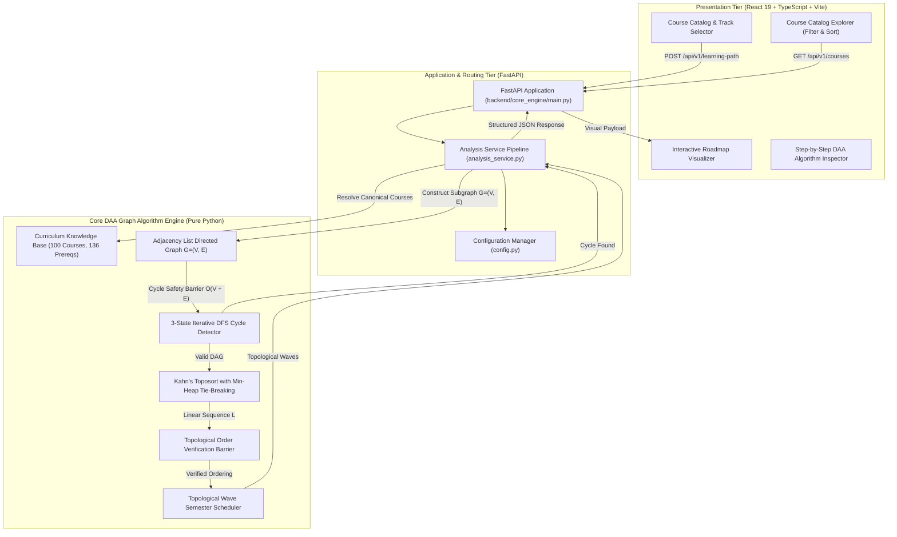

# System Architecture — Dependency-Aware Course Registration Assistant

The Course Registration Assistant is a deterministic, graph-theoretic scheduling system built as a **Design and Analysis of Algorithms (DAA)** capstone project. It models academic curricula as **Directed Acyclic Graphs (DAGs)**, detects circular prerequisite deadlocks in linear time, and generates mathematically valid course-taking sequences using **Kahn's Topological Sort**.

---

## 1. High-Level System Architecture

The architecture enforces a modular separation of concerns between client visualization, API routing, and the core algorithmic engine:

---

## 2. Core DAA Algorithmic Components

All graph structures and algorithms are implemented in pure Python (`backend/daa_engine/`) with zero external graph library dependencies.

### 2.1 Adjacency List Directed Graph (`DirectedGraph`)
- **Representation:** Compact adjacency list `Dict[str, List[str]]` mapping each course vertex $u$ to its outgoing dependent neighbors $\{v \mid (u, v) \in E\}$.
- **In-Degree Lookup:** Dedicated `Dict[str, int]` maintaining the count of incoming prerequisite edges for each vertex.
- **Space Efficiency:** $\mathcal{O}(|V| + |E|)$ memory footprint.

### 2.2 Iterative 3-State DFS Cycle Detector (`detect_cycle_dfs`)
- **Time Complexity:** $\mathcal{O}(|V| + |E|)$
- **Space Complexity:** $\mathcal{O}(|V|)$
- **State Coloring:**
  - `0 (WHITE)`: Unvisited node.
  - `1 (GRAY)`: Currently active on the DFS traversal stack.
  - `2 (BLACK)`: Completely explored with all descendants verified.
- **Back-Edge Detection:** If traversal encounters an edge to a `GRAY` node, a back-edge is confirmed, proving a directed cycle.
- **Stack Safety:** Uses an explicit heap stack `[(vertex, neighbor_index)]` rather than Python recursion, eliminating stack-overflow risks on deep linear prerequisite chains.

### 2.3 Deterministic Kahn's Topological Sort (`topological_sort_kahn`)
- **Time Complexity:** $\mathcal{O}(|V| \log |V| + |E|)$
- **Space Complexity:** $\mathcal{O}(|V| + |E|)$
- **In-Degree Decay:** Vertices with in-degree 0 are queued into a Python `heapq` priority min-heap.
- **Deterministic Tie-Breaking:** When multiple courses reach in-degree 0 simultaneously, the min-heap dequeues the lexicographically smallest course ID first, ensuring reproducible registration sequences across identical inputs.

### 2.4 Topological Wave Semester Partitioning
- Mutually independent courses (in-degree 0 at step $t$) form a **topological wave**.
- In university degree planning, each wave naturally represents a **semester cohort**: courses that a student can take concurrently without prerequisite conflicts.
- As the student completes a semester wave, outgoing edges are removed, in-degrees decay, and the next semester's wave is unlocked.

---

## 3. Curriculum Knowledge Base

The curriculum knowledge base (`backend/knowledge_base/courses.json`) contains **100 accredited courses** and **136 validated prerequisite relationships** spanning Semesters 1 through 8, constructed directly from the official MRIIRS B.Tech Computer Science and Engineering syllabus booklet.

- **Integrity Validation:** Every prerequisite edge $(u \to v)$ satisfies $\text{semester}(u) \le \text{semester}(v)$.
- **Acyclicity:** Verified strictly acyclic (0 cycles).
- **Domain Coverage:** Mathematics, Core CS, Systems, AI/ML, Data Science, Security, and Modern Cloud Infrastructure.
