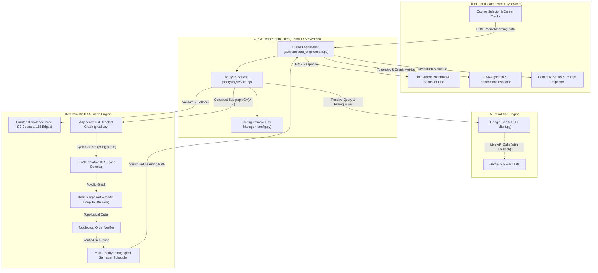

# Pathwise System Architecture

Pathwise is an AI-assisted, prerequisite-aware course learning-path generator built as a rigorous **Design and Analysis of Algorithms (DAA)** project. It combines large language model intelligence (Google Gemini 2.5 Flash Lite) for natural language course resolution with **deterministic, mathematically proven graph algorithms** for prerequisite ordering and semester scheduling.

---

## 1. High-Level System Architecture

The system enforces a strict architectural boundary: **AI assists with natural language discovery and candidate prerequisite extraction; custom graph algorithms determine all ordering, cycle detection, and scheduling.**

---

## 2. Core Execution Pipeline

When a user submits a learning goal and list of target courses:

1. **Course Resolution & Validation (`backend/core_engine/analysis_service.py`):**
   - Courses are matched against the 70 curated courses in `backend/knowledge_base/courses.json`.
   - If a course query is unknown, ambiguous, or lacks explicit prerequisites, the backend invokes `backend/ai_engine/client.py` using Google Gemini 2.5 Flash Lite.
   - If the Gemini API is unreachable, misconfigured, or returns invalid syntax, the system automatically falls back to curated prerequisite mappings, recording an explicit warning banner in the payload without crashing.

2. **Graph Construction (`backend/daa_engine/graph.py`):**
   - Creates a directed graph $G = (V, E)$ using an adjacency list representation.
   - Each course forms a vertex $v \in V$. Each prerequisite relationship is a directed edge $(u, v) \in E$, meaning $u$ must be completed before $v$.
   - Repeated edge insertions are deduplicated via an internal set registry, preventing corrupt in-degree counts.

3. **Cycle Detection & Path Reconstruction (`backend/daa_engine/graph.py`):**
   - Prior to sorting, an iterative 3-state Depth-First Search (`WHITE`, `GRAY`, `BLACK`) inspects the graph for back-edges.
   - Because it uses an explicit call stack rather than Python recursion, it handles deep linear chains exceeding 1500+ vertices without recursion overflow.
   - If a cycle exists ($A \to B \to C \to A$), it extracts the exact circular dependency path and raises a structured `CycleError`.

4. **Deterministic Topological Sorting (`backend/daa_engine/graph.py`):**
   - Kahn's algorithm processes vertices using an in-degree counter dictionary and a Python `heapq` min-heap.
   - Min-heap priority ensures deterministic, reproducible tie-breaking whenever multiple courses have zero unmet prerequisites.
   - Run time: $\mathcal{O}(E + V \log V)$.

5. **Topological Order Verification (`backend/daa_engine/graph.py`):**
   - Before passing the sequence to the scheduler, `verify_topological_order` performs a formal mathematical verification:
     - Cardinality check: $|order| == |V|$.
     - Vertex preservation: $\text{set}(order) == V$.
     - Precedence assertion: For every edge $(u, v) \in E$, $\text{index}(u) < \text{index}(v)$.

6. **Multi-Priority Semester Scheduling (`backend/daa_engine/scheduler.py`):**
   - Partitions the linear topological order into academic semesters subject to constraints:
     - `max_courses_per_semester` (default: 3).
     - `max_difficulty_per_semester` (sum of credit/difficulty weights).
     - Strict prerequisite isolation (a course and its prerequisite cannot share the same semester).
   - Uses multi-priority list scheduling prioritizing critical path length, course difficulty, and lexicographical IDs.
   - Validates semester allocations with `verify_semester_schedule`.

---

## 3. Strict Boundary: AI vs. Deterministic DAA

| Responsibility | Handled By | Rationale |
| :--- | :--- | :--- |
| **Natural Language Understanding** | Google Gemini 2.5 Flash Lite | Interpreting informal user queries, matching fuzzy course names, extracting prerequisite candidates from unstructured syllabi. |
| **Course Catalog Fallback** | Curated Knowledge Base (70 courses) | Offline guarantee: Zero dependencies on external networks to produce valid academic paths. |
| **Cycle Detection** | Iterative 3-State DFS (`graph.py`) | LLMs cannot reliably detect cycles in complex multi-branch graphs. DFS guarantees $100\%$ precision with back-edge path reconstruction. |
| **Topological Ordering** | Kahn's Algorithm + Min-Heap (`graph.py`) | Mathematical determinism: An identical set of courses must yield the identical prerequisite order across all runs and platforms. |
| **Order Verification** | Order Verifier (`graph.py`) | Formal assertion: Prevents any invalid sequence from ever reaching the student or UI. |
| **Semester Partitioning** | List Scheduler (`scheduler.py`) | Hard constraint satisfaction: Workload balancing, max course limits, and multi-tier priority rules. |

---

## 4. Resilience & Graceful Degradation Strategy

1. **Missing or Invalid Gemini API Key:**
   - The backend checks `config.GEMINI_API_KEY`. If unconfigured, synthetic, or rejected by Google, `resolve_courses_and_prerequisites` falls back to exact and token-based knowledge base matching.
   - The API response returns `ai_status: "fallback"` with an informative reason string.
2. **Ambiguous or Non-Existent Courses:**
   - If an input cannot be mapped to an academic subject, a clean HTTP 400 error (`CourseResolutionError`) explains why and suggests valid alternatives.
3. **Circular Dependencies:**
   - If user input or an external syllabus creates a prerequisite cycle, Kahn's algorithm and iterative DFS catch it instantly and return HTTP 400 (`CycleError`) detailing the circular chain: e.g. `Calculus I -> Calculus II -> Calculus I`.
